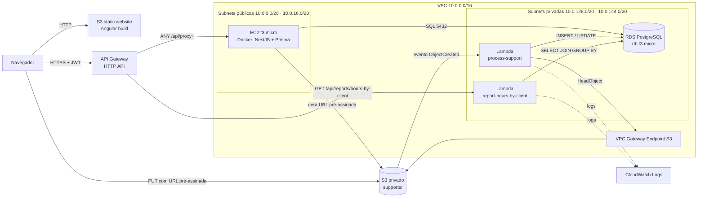
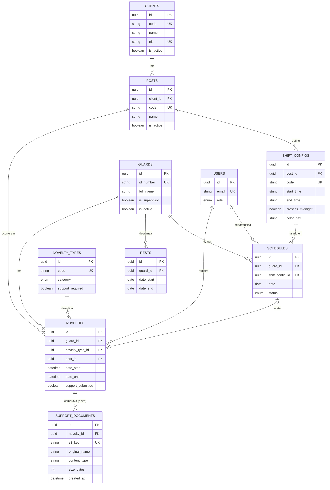

# Design — Clave Seguridad CTA · Programação de Turnos

> **Versão 0.3** (Aula 3 · 23/10) — alinhada ao código existente no repositório (`backend/` NestJS + Prisma, `frontend/` Angular). Baseado em `spec/spec.md` v0.3. Região: `us-east-1` (Learner Lab).
> Legenda: ✅ já existe no código · 🆕 a implementar no Projeto 2.

## 1. Visão geral

| Camada | Tecnologia | Onde roda na AWS | Estado |
|---|---|---|---|
| Front-end | Angular 20 + Angular Material + FullCalendar | **S3 static website** | ✅ código · 🆕 publicação |
| API (CRUD, login, URL pré-assinada) | NestJS 11 + Prisma 7, prefixo global `/api`, JWT | **Docker numa EC2 t3.micro** | ✅ código · 🆕 Dockerfile e deploy |
| Entrada da API | — | **API Gateway (HTTP API)** | 🆕 |
| Banco | PostgreSQL 16 | **RDS db.t3.micro** em subnets privadas | ✅ schema · 🆕 RDS |
| Processar suporte (RF-03) | Node.js 20 + `pg` | **Lambda `process-support`** | 🆕 |
| Relatório (RF-04) | Node.js 20 + `pg` | **Lambda `report-hours-by-client`** | 🆕 |
| Arquivos de suporte | — | **S3 privado `cta-supports-*`** | 🆕 |

## 2. Diagrama de arquitetura



**Fluxo de exemplo (RF-02 + RF-03):**
1. O vigilante (ou o coordenador) abre uma novidade de incapacidade e escolhe `incapacidad.pdf`.
2. O front chama `POST /api/novelties/{id}/upload-url` → a EC2 devolve uma URL pré-assinada para `supports/novelty-{id}/{uuid}-incapacidad.pdf`.
3. O navegador faz `PUT` do arquivo direto no S3.
4. O S3 dispara `process-support`, que lê o `ContentType` (HeadObject via endpoint), insere em `support_documents` e marca `novelties.support_submitted = true`.
5. A novidade some do filtro "suporte pendente" (`GET /api/novelties?support_pending=true`).

## 3. Modelo de dados

Fonte da verdade: `backend/prisma/schema.prisma`. Tabelas em snake_case, IDs `uuid`.



**Relações que atendem o RF-01:**
- `clients` 1:N `posts` 1:N `shift_configs` (cadastros encadeados).
- `guards` N:N `shift_configs`, resolvida por `schedules` (vigilante × turno × data), com `UNIQUE (guard_id, date, shift_config_id)`.

**Única mudança no schema (🆕):** o modelo `SupportDocument` (tabela `support_documents`), gerado como nova migration:

```prisma
model SupportDocument {
  id            String   @id @default(uuid())
  novelty_id    String
  s3_key        String   @unique
  original_name String
  content_type  String
  size_bytes    Int
  created_at    DateTime @default(now())

  novelty Novelty @relation(fields: [novelty_id], references: [id])

  @@map("support_documents")
}
// e em Novelty: support_documents SupportDocument[]
```

**Suporte pendente** = `novelty_types.support_required = true` **e** `novelties.support_submitted = false`.

## 4. Rotas da API

Base: `https://{api-id}.execute-api.us-east-1.amazonaws.com`. Todas exigem `Authorization: Bearer <JWT>`, exceto o login.

### 4.1 Rotas existentes ✅ (NestJS na EC2)

| Recurso | Rotas | Papéis | HU |
|---|---|---|---|
| Login | `POST /api/auth/login` | público | HU-09 |
| Usuários | `GET·POST /api/users` · `GET·PATCH·DELETE /api/users/:id` | admin | — |
| Clientes | `GET·POST /api/clients` · `GET·PATCH·DELETE /api/clients/:id` (DELETE inativa) | admin (escrita) | HU-01 |
| Postos | `GET·POST /api/posts` · `GET·PATCH·DELETE /api/posts/:id` | admin (escrita) | HU-01 |
| Tipos de turno | `GET·POST /api/shift-configs` · `GET·PATCH·DELETE /api/shift-configs/:id` | admin (escrita) | HU-02 |
| Vigilantes | `GET·POST /api/security-guards` · `GET·PATCH /api/security-guards/:id` · `PATCH …/:id/terminate` · `PATCH …/:id/reactivate` · `GET …/without-schedule` | admin, coordinator | HU-03 |
| Programação | `POST /api/schedules` · `POST /api/schedules/bulk` · `GET /api/schedules/calendar` · `GET /api/schedules/guard/:guardId/monthly` · `GET·PATCH·DELETE /api/schedules/:id` | admin, coordinator (viewer lê) | HU-04 |
| Descansos | `GET·POST /api/rests` · `GET·PATCH·DELETE /api/rests/:id` | admin, coordinator | HU-05 |
| Novidades | `GET /api/novelties/types` · `GET·POST /api/novelties` (filtro `support_pending`) · `GET·PATCH·DELETE /api/novelties/:id` | admin, coordinator | HU-06 |
| Relatórios Excel | `GET /api/reports/{novelties,monthly,by-client,pending-guards,shift-crosses}` e `…/excel` | admin, coordinator | fora do RF-04 |
| Swagger | `GET /api/docs` | público | — |

Exemplo — conflito em `POST /api/schedules` (já implementado):
```json
// 409 Conflict
{ "statusCode": 409, "message": "Cruce de turnos: Pedro Gómez ya tiene el turno 214 (05:00–17:00) ese día" }
```

### 4.2 Rotas novas 🆕

| Método | Rota | Onde | HU |
|---|---|---|---|
| POST | `/api/novelties/:id/upload-url` | NestJS (EC2) | HU-07 |
| GET | `/api/novelties/:id/documents` | NestJS (EC2) | HU-07 / HU-08 |
| GET | `/api/reports/hours-by-client?month=YYYY-MM` | **Lambda** `report-hours-by-client` | HU-09 |

> No API Gateway HTTP API, uma rota exata tem prioridade sobre `ANY /api/{proxy+}`. Por isso `GET /api/reports/hours-by-client` vai para a Lambda e todo o resto de `/api/*` vai para a EC2, e o front continua usando uma única URL base.

Exemplo — `POST /api/novelties/7c1e…/upload-url`
```json
// request
{ "fileName": "incapacidad.pdf", "contentType": "application/pdf", "size": 182340 }
// 201
{ "uploadUrl": "https://cta-supports-xyz.s3.amazonaws.com/supports/novelty-7c1e…/3f2a-incapacidad.pdf?X-Amz-…",
  "key": "supports/novelty-7c1e…/3f2a-incapacidad.pdf", "expiresIn": 300 }
```

### 4.3 Consulta do relatório (RF-04)

```sql
SELECT c.id   AS client_id,
       c.name AS client,
       p.code AS post_code,
       p.name AS post,
       COUNT(s.id) AS shifts,
       ROUND(SUM(
         EXTRACT(EPOCH FROM (sc.end_time::time - sc.start_time::time)) / 3600
         + CASE WHEN sc.crosses_midnight THEN 24 ELSE 0 END
       )::numeric, 1) AS hours
FROM clients c
JOIN posts         p  ON p.client_id        = c.id
JOIN shift_configs sc ON sc.post_id         = p.id
JOIN schedules     s  ON s.shift_config_id  = sc.id
WHERE s.date >= $1::date
  AND s.date <  ($1::date + INTERVAL '1 month')
  AND s.status <> 'rest'
GROUP BY c.id, c.name, p.id, p.code, p.name
ORDER BY c.name, p.name;
```
`$1` = primeiro dia do mês (ex.: `2026-10-01`). Exemplo de cálculo: turno 17:00–05:00 → `05−17 = −12 h`, `+24` porque cruza a meia-noite = **12 h**.

### 4.4 CORS

- **API Gateway:** `AllowOrigins` = URL do S3 website (e `http://localhost:4200` em desenvolvimento); métodos `GET, POST, PATCH, DELETE, OPTIONS`; headers `Content-Type, Authorization`.
- **NestJS:** já usa `FRONTEND_URL` em `enableCors` → definir com a URL do S3 website no `.env` da EC2.
- **Bucket de suportes:** `AllowedMethods: PUT, GET`, `AllowedOrigins` = URL do S3 website, `AllowedHeaders: *`.

## 5. Recursos AWS

| Recurso | Nome | Configuração |
|---|---|---|
| VPC | `cta-vpc` | 10.0.0.0/16 + Internet Gateway |
| Subnets públicas | `cta-subnet-public1/2` | 10.0.0.0/20 (1a) e 10.0.16.0/20 (1b), criadas pelo assistente "VPC and more"; a EC2 usa a 1 |
| Subnets privadas | `cta-subnet-private1/2` | 10.0.128.0/20 (1a) e 10.0.144.0/20 (1b); o RDS exige 2 AZs |
| Route tables | `cta-rt-public` / `cta-rt-private` | pública → IGW; privada → só local + endpoint S3 |
| VPC Endpoint | `cta-s3-endpoint` | Gateway, S3, associado a `cta-rt-private` |
| RDS | `cta-db` | PostgreSQL 16, db.t3.micro, 20 GB gp3, sem acesso público |
| EC2 | `cta-api` | t3.micro, Amazon Linux 2023, Docker, `LabInstanceProfile` |
| S3 website | `cta-front-*` | Static website hosting, leitura pública (landing na Aula 2, Angular na Aula 4) |
| S3 suportes | `cta-supports-*` | Privado, CORS, evento `s3:ObjectCreated:*` prefixo `supports/` → `process-support` |
| Lambda | `process-support` | Node.js 20, `LabRole`, VPC privada, `sg-lambda` |
| Lambda | `report-hours-by-client` | Node.js 20, `LabRole`, VPC privada, `sg-lambda` |
| API Gateway | `cta-api-gw` | HTTP API, rotas §4, CORS §4.4 |

## 6. Security Groups

| SG | Entrada | Saída | Por quê |
|---|---|---|---|
| `sg-ec2-api` | TCP 3000 de 0.0.0.0/0 · TCP 22 da prefix list `com.amazonaws.us-east-1.ec2-instance-connect` | Tudo | O API Gateway HTTP API chega à EC2 pela internet (VPC Link exigiria NLB/ALB, que são pagos). SSH só pelo EC2 Instance Connect do console, para o deploy. |
| `sg-lambda` | Nenhuma | TCP 5432 → `sg-rds` · TCP 443 → prefix list do S3 | A Lambda só inicia conexões. |
| `sg-rds` | TCP 5432 **somente de `sg-ec2-api` e `sg-lambda`** | — | RNF-01: nada da internet chega ao banco. |

Para rodar migrations e o seed, conecto **a partir da EC2** (o RDS não tem IP público).

## 7. ADRs

### ADR-01 — CRUD em container (EC2 + Docker), não em Lambda · **RNF-04**
- **Contexto:** o backend já existe: 10 módulos NestJS, cerca de 50 rotas, JWT com papéis e validação de cruces de turno.
- **Decisão:** empacotar o NestJS num container Docker e rodar numa EC2 t3.micro. Lambda só onde o enunciado exige (RF-03 e RF-04).
- **Por quê:** reaproveita 100% do código; reescrever cerca de 50 rotas como funções seria trabalho em dobro. O Prisma em Lambda aumenta o pacote e o cold start e abre uma conexão ao RDS por instância.
- **Consequências:** a EC2 precisa estar ligada (custo baixo em t3.micro). O IP público muda a cada sessão → atualizar a integração do API Gateway (passo do README). Sem auto scaling, o que é aceitável para o volume da empresa.

### ADR-02 — API Gateway como única porta de entrada
- **Decisão:** HTTP API com `ANY /api/{proxy+}` → EC2 e `GET /api/reports/hours-by-client` → Lambda.
- **Por quê:** o front conhece uma única URL estável entre sessões; CORS num só lugar; atende o RF-04, que exige API Gateway.

### ADR-03 — Lambdas com `pg` puro, sem Prisma
- **Decisão:** as duas Lambdas usam o driver `pg` (já é dependência do backend) com SQL parametrizado.
- **Por quê:** pacote pequeno, cold start rápido, e o `JOIN/GROUP BY` fica explícito no código, como pede o RF-04.

### ADR-04 — Manter `rests` e `novelties` separados
- **Contexto:** a v0.2 da spec propunha unificar o descanso como tipo de novidade.
- **Decisão:** manter como está no código: `rests` (planejamento futuro) e `novelties` (eventos que afetam a folha).
- **Por quê:** a validação `isOnRest` e as telas já existem; unificar agora seria retrabalho sem ganho para os requisitos.

### ADR-05 — RF-03 = registrar o suporte da novidade
- **Alternativas:** miniatura de imagem (exige `sharp`, binário nativo na Lambda); importar CSV da planilha (validação complexa).
- **Decisão:** a Lambda grava os metadados em `support_documents` e marca `support_submitted = true`.
- **Por quê:** o campo `support_submitted` e o filtro `support_pending` **já existem**; a Lambda só automatiza o que hoje é manual.

### ADR-06 — URL da API no build de produção
- **Decisão:** `environment.prod.ts` → `apiUrl: 'https://{api-id}.execute-api.us-east-1.amazonaws.com/api'`.
- **Por quê:** a URL do API Gateway não muda entre sessões do Learner Lab; quem muda é o IP da EC2, que fica escondido atrás do API Gateway. Atende o RNF-03 sem IP fixo e sem mudar a lógica do front.

### ADR-07 — Schema versionado com migrations do Prisma
- **Decisão:** `backend/prisma/migrations/*/migration.sql` são os scripts SQL versionados (já existe `20260618013948_init`). Aplicar com `npx prisma migrate deploy` e popular com `npx prisma db seed` a partir da EC2.
- **Por quê:** evita manter o schema em dois lugares.

### ADR-10 — Conexão SSL com o RDS
- **Contexto:** o RDS PostgreSQL 16 exige SSL (`rds.force_ssl = 1`). O driver `pg` valida o certificado e rejeita o da AWS, que não está na lista de confiança do Node.
- **Decisão:** variável `DATABASE_SSL=true` → o `Pool` usa `ssl: { rejectUnauthorized: false }`. O Prisma CLI (migrations) usa `sslmode=prefer` por padrão e conecta sem mudanças.
- **Por quê:** o tráfego continua criptografado e fica só dentro da VPC privada; não é preciso distribuir o bundle de certificados do RDS.

### ADR-08 — Segredos fora do repositório
- **Decisão:** `DATABASE_URL`, `DATABASE_SSL`, `JWT_SECRET`, `FRONTEND_URL` e `SEED_PASSWORD` em `.env` na EC2 (ignorado pelo Git e pelo Docker) e em variáveis de ambiente das Lambdas. O `docker-compose.yml` e o `seed.ts` deixaram de ter senhas escritas; `backend/.env.example` documenta as variáveis sem valores.
- **Por quê:** RNF-02. **Bônus opcional:** mover os segredos para o Parameter Store (SecureString).

### ADR-09 — Autenticação no relatório em Lambda
- **Decisão:** a Lambda `report-hours-by-client` valida o mesmo JWT do NestJS (biblioteca `jsonwebtoken` + `JWT_SECRET` em variável de ambiente) e aceita os papéis `admin` e `coordinator`.
- **Por quê:** o relatório expõe dados de faturamento; reutilizar o token evita um segundo login.
