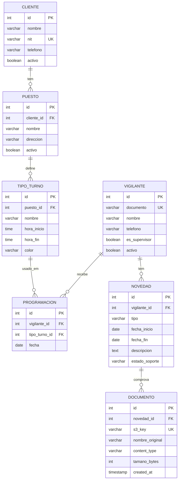

# Design — Clave Seguridad CTA · Programação de Turnos

> Versão 0.1 (Aula 2 · 16/10). Baseado em `specs/spec.md` v0.2. Região: `us-east-1` (Learner Lab).

## 1. Visão geral

- **Front-end:** Angular (build estático) no **S3 static website**.
- **Entrada única da API:** **API Gateway (HTTP API)** — uma URL estável e CORS num só lugar.
  - `ANY /api/{proxy+}` → HTTP proxy para o **NestJS em Docker numa EC2 t3.micro** (CRUD, RF-01; URL pré-assinada, RF-02).
  - `GET /relatorios/programacion-por-cliente` → **Lambda `relatorio-programacion`** (RF-04).
- **Uploads:** bucket S3 privado; o evento `ObjectCreated` em `soportes/` dispara a **Lambda `procesa-soporte`** (RF-03).
- **Banco:** **RDS PostgreSQL db.t3.micro** em subnets privadas (RNF-01).
- **Sem NAT Gateway:** as Lambdas na VPC acessam o S3 por **VPC Gateway Endpoint** (gratuito).

## 2. Diagrama de arquitetura

```mermaid
flowchart LR
  U[Navegador] -->|HTTP| W[S3 static website<br/>Angular]
  U -->|HTTPS /api/* e /relatorios/*| G[API Gateway<br/>HTTP API]
  U -->|PUT com URL pré-assinada| B[(S3 uploads<br/>soportes/)]

  subgraph VPC 10.0.0.0/16
    subgraph Subnet pública 10.0.1.0/24
      E[EC2 t3.micro<br/>Docker: NestJS + Prisma]
    end
    subgraph Subnets privadas 10.0.11.0/24 · 10.0.12.0/24
      R[(RDS PostgreSQL<br/>db.t3.micro)]
      L1[Lambda<br/>procesa-soporte]
      L2[Lambda<br/>relatorio-programacion]
    end
    VE[VPC Gateway Endpoint S3]
  end

  G -->|/api/*| E
  G -->|/relatorios/*| L2
  E -->|SQL 5432| R
  E -->|gera URL pré-assinada| B
  B -->|evento ObjectCreated| L1
  L1 -->|HeadObject| VE --> B
  L1 -->|INSERT/UPDATE| R
  L2 -->|SELECT JOIN GROUP BY| R
  L1 & L2 -.->|logs| CW[CloudWatch Logs]
```

**Fluxo de exemplo (RF-02 + RF-03):**
1. O vigilante abre a novidade #45 e escolhe `atestado.pdf`.
2. O front chama `POST /api/novedades/45/upload-url` → a EC2 devolve a URL pré-assinada para `soportes/novedad-45/3f2a…-atestado.pdf`.
3. O navegador faz `PUT` direto no S3.
4. O S3 dispara `procesa-soporte`, que lê o `ContentType` (HeadObject via endpoint), insere em `documento` e muda a novidade #45 para `ENTREGADO`.

## 3. Modelo de dados (ER)



Notas:
- Os nomes das tabelas seguem o código existente (espanhol).
- `PROGRAMACION` resolve o N:N entre `VIGILANTE` e `TIPO_TURNO`. Restrição `UNIQUE (vigilante_id, tipo_turno_id, fecha)`.
- `NOVEDAD.tipo` ∈ `DESCANSO, INCAPACIDAD, VACACIONES, LICENCIA, PERMISO, SUSPENSION`.
- `NOVEDAD.estado_soporte` ∈ `NO_REQUIERE, PENDIENTE, ENTREGADO`.
- `CHECK (fecha_fin >= fecha_inicio)` em `NOVEDAD`.
- Scripts versionados em `database/` (ver ADR-07).

## 4. Rotas da API

Base: `https://{api-id}.execute-api.us-east-1.amazonaws.com`

### 4.1 CRUD — NestJS na EC2 (prefixo `/api`)

| Método | Rota | Descrição | HU |
|---|---|---|---|
| GET | `/api/health` | Verifica API e conexão com o banco | — |
| GET · POST | `/api/clientes` | Listar (`?activo=true`) · criar | HU-01 |
| GET · PUT · DELETE | `/api/clientes/{id}` | Detalhar · editar · inativar | HU-01 |
| GET · POST | `/api/clientes/{id}/puestos` | Postos do cliente · criar posto | HU-01 |
| PUT · DELETE | `/api/puestos/{id}` | Editar · inativar posto | HU-01 |
| GET · POST | `/api/puestos/{id}/tipos-turno` | Turnos do posto · criar | HU-02 |
| PUT · DELETE | `/api/tipos-turno/{id}` | Editar · excluir turno | HU-02 |
| GET · POST | `/api/vigilantes` | Listar · criar | HU-03 |
| GET · PUT · DELETE | `/api/vigilantes/{id}` | Detalhar · editar · inativar | HU-03 |
| GET | `/api/programaciones?desde=&hasta=&clienteId=&vigilanteId=` | Grade do período | HU-04 |
| POST | `/api/programaciones` | Atribuir turno (valida RN-01/RN-02 → 409) | HU-04 |
| DELETE | `/api/programaciones/{id}` | Remover atribuição | HU-04 |
| GET · POST | `/api/novedades?vigilanteId=&estadoSoporte=` | Listar/filtrar · criar | HU-05 |
| PUT · DELETE | `/api/novedades/{id}` | Editar · excluir | HU-05 |
| POST | `/api/novedades/{id}/upload-url` | Gera URL pré-assinada de `PUT` | HU-06 |
| GET | `/api/novedades/{id}/documentos` | Documentos + URL pré-assinada de download | HU-06/07 |

Exemplo — `POST /api/novedades/45/upload-url`
```json
// request
{ "fileName": "atestado.pdf", "contentType": "application/pdf", "size": 182340 }
// response 200
{ "uploadUrl": "https://…s3.amazonaws.com/soportes/novedad-45/3f2a-atestado.pdf?X-Amz-…",
  "key": "soportes/novedad-45/3f2a-atestado.pdf", "expiresIn": 300 }
```

Exemplo — conflito em `POST /api/programaciones`
```json
// response 409
{ "error": "CONFLITO_HORARIO", "message": "O vigilante 1023456789 já está no turno Diurno 06:00–18:00 em 2026-10-10" }
```

### 4.2 Relatório — Lambda (RF-04)

| Método | Rota | Integração |
|---|---|---|
| GET | `/relatorios/programacion-por-cliente?mes=YYYY-MM` | Lambda `relatorio-programacion` |

```sql
SELECT c.id AS cliente_id, c.nombre AS cliente, p.nombre AS puesto,
       COUNT(pr.id) AS turnos,
       ROUND(SUM(EXTRACT(EPOCH FROM
         CASE WHEN t.hora_fin > t.hora_inicio THEN t.hora_fin - t.hora_inicio
              ELSE t.hora_fin - t.hora_inicio + INTERVAL '24 hours' END)) / 3600, 1) AS horas
FROM cliente c
JOIN puesto p        ON p.cliente_id = c.id
JOIN tipo_turno t    ON t.puesto_id = p.id
JOIN programacion pr ON pr.tipo_turno_id = t.id
WHERE pr.fecha >= $1::date AND pr.fecha < ($1::date + INTERVAL '1 month')
GROUP BY c.id, c.nombre, p.id, p.nombre
ORDER BY c.nombre, p.nombre;
```
`$1` = primeiro dia do mês (ex.: `2026-10-01`). Consulta parametrizada (sem concatenar strings).

### 4.3 CORS

- API Gateway: `AllowOrigins` = URL do S3 website (em desenvolvimento, também `http://localhost:4200`); métodos `GET, POST, PUT, DELETE, OPTIONS`; header `Content-Type`.
- Bucket de uploads: `AllowedMethods: PUT, GET`, `AllowedOrigins` = URL do S3 website, `AllowedHeaders: *`.

## 5. Recursos AWS

| Recurso | Nome sugerido | Configuração |
|---|---|---|
| VPC | `cta-vpc` | 10.0.0.0/16, Internet Gateway |
| Subnet pública | `cta-public-a` | 10.0.1.0/24 (us-east-1a), auto-assign IP público |
| Subnets privadas | `cta-private-a` / `cta-private-b` | 10.0.11.0/24 (1a) / 10.0.12.0/24 (1b) — o RDS exige 2 AZs |
| Route tables | `cta-rt-public` / `cta-rt-private` | pública → IGW; privada → só local + endpoint S3 |
| VPC Endpoint | `cta-s3-endpoint` | Gateway, S3, associado a `cta-rt-private` |
| RDS | `cta-db` | PostgreSQL 16, db.t3.micro, 20 GB gp3, sem acesso público, subnet group privado |
| EC2 | `cta-api` | t3.micro, Amazon Linux 2023, Docker, `LabInstanceProfile` |
| S3 website | `cta-front-{sufixo}` | Static website hosting, leitura pública |
| S3 uploads | `cta-uploads-{sufixo}` | Privado, CORS, evento → `procesa-soporte` (prefixo `soportes/`) |
| Lambda | `procesa-soporte` | Node.js 20, `LabRole`, VPC privada, SG `sg-lambda` |
| Lambda | `relatorio-programacion` | Node.js 20, `LabRole`, VPC privada, SG `sg-lambda` |
| API Gateway | `cta-api-gw` | HTTP API, rotas §4, CORS |

## 6. Security Groups

| SG | Entrada | Saída | Por quê |
|---|---|---|---|
| `sg-ec2-api` | TCP 3000 de 0.0.0.0/0 · TCP 22 do IP do integrante | Tudo | O API Gateway HTTP API chama a EC2 pela internet (VPC Link exigiria NLB/ALB pagos). SSH só para deploy. |
| `sg-lambda` | Nenhuma | TCP 5432 → `sg-rds` · TCP 443 → prefix list do S3 | A Lambda só inicia conexões. |
| `sg-rds` | TCP 5432 **de `sg-ec2-api` e `sg-lambda`** | — | RNF-01: ninguém da internet chega ao banco. |

Para administrar o banco (rodar scripts SQL), conectamos via `psql` **a partir da EC2**.

## 7. ADRs

### ADR-01 — CRUD em container (EC2 + Docker) e não em Lambda · **RNF-04**
- **Contexto:** o backend já existe em NestJS + Prisma, com cerca de 20 rotas de CRUD e validação de conflitos.
- **Decisão:** rodar o NestJS como container Docker numa EC2 t3.micro. Lambda só para RF-03 (evento) e RF-04 (relatório).
- **Por quê:** reaproveita o código sem reescrever cada rota como função; o Prisma em Lambda aumenta o pacote e o cold start e abre muitas conexões no RDS; um único deploy (`docker run`) é mais simples de demonstrar.
- **Consequências:** a EC2 precisa estar ligada (custo baixo em t3.micro). O DNS público muda a cada sessão → atualizamos a integração do API Gateway (passo do README). Sem auto scaling (aceitável para o volume da empresa).

### ADR-02 — API Gateway como única porta de entrada
- **Decisão:** HTTP API com proxy `/api/{proxy+}` para a EC2 e rota `/relatorios/...` para a Lambda.
- **Por quê:** o front conhece **uma** URL que não muda entre sessões; CORS configurado num só lugar; atende RF-04, que exige API Gateway.

### ADR-03 — Lambdas com `pg` puro, sem Prisma
- **Decisão:** as duas Lambdas usam o driver `pg` com SQL parametrizado.
- **Por quê:** pacote pequeno, cold start rápido, e o SQL com `JOIN/GROUP BY` fica explícito (o RF-04 pede isso e o professor pode perguntar).

### ADR-04 — Descanso é um tipo de Novidade
- **Decisão:** não criar a tabela `descanso`; usar `novedad.tipo = 'DESCANSO'`.
- **Por quê:** uma tabela, uma tela e uma consulta para a regra RN-01. Menos código, mesmo comportamento.

### ADR-05 — RF-03 = registrar suporte (e não miniatura ou importação de CSV)
- **Alternativas:** miniatura de imagem (exige `sharp`, binário nativo); importação de CSV da planilha (validação complexa).
- **Decisão:** a Lambda grava os metadados em `documento` e marca a novidade como `ENTREGADO`.
- **Por quê:** resolve uma dor real do RH, usa a mesma entidade do RF-02 (um único fluxo de upload) e é simples de testar.

### ADR-06 — Configuração do front em tempo de execução
- **Decisão:** o Angular lê `assets/config.json` (`{ "apiUrl": "..." }`) ao iniciar.
- **Por quê:** RNF-03 — trocar a URL não exige recompilar; nenhum IP no código.

### ADR-07 — Schema versionado com migrations do Prisma
- **Decisão:** as migrations do Prisma (`prisma/migrations/*/migration.sql`) são os scripts SQL versionados; o `database/seed.sql` tem dados de exemplo. Aplicamos com `npx prisma migrate deploy` a partir do container na EC2.
- **Por quê:** evita manter o schema em dois lugares (Prisma e SQL manual).

### ADR-08 — Segredos
- **Decisão:** `DATABASE_URL` em `.env` na EC2 (no `.gitignore`) e variáveis de ambiente nas Lambdas. **Bônus opcional:** mover para o Parameter Store (SecureString).
- **Por quê:** RNF-02, sem depender de criar roles IAM.
